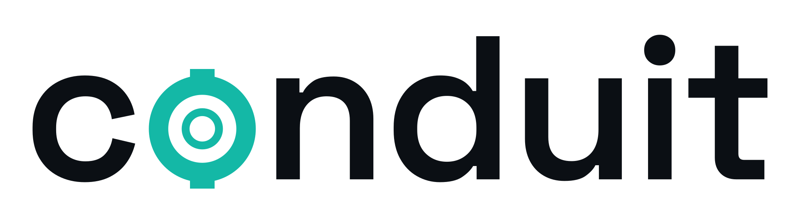

<p align="center">
  <picture>
    <source media="(prefers-color-scheme: dark)" srcset="docs/assets/logo/conduit-wordmark-flange-teal-dark.svg">
    
  </picture>
</p>

# Conduit

Conduit flags the lines in your code when an outside service or SDK you depend on changes.

## What it does

On a dependency-bump pull request, Conduit finds the call sites the new SDK release breaks. It rewrites the safe ones with NVIDIA Nemotron on Nebius Token Factory, then checks them with the repo's own tests: a baseline run versus the run after the rewrite, a coverage gate, a dict-key check, and a dropped-argument check. The rest are marked needs-human with a reason, or skipped when another rewrite already covers the line. On GitHub it posts one comment on the pull request, and it never pushes or merges.

## Built with NVIDIA Nemotron on Nebius Token Factory

Conduit calls two models through [Nebius Token Factory](https://docs.tokenfactory.nebius.com/api-reference/introduction). Token Factory is the Nebius product this repository uses.

`nvidia/Nemotron-3-Ultra-550b-a55b` writes the rewrites. `nvidia/NVIDIA-Nemotron-3-Nano-30B-A3B` writes the one-line why.

Both go to Token Factory's OpenAI-compatible chat-completions API at `https://api.tokenfactory.nebius.com/v1/`. Thinking is off (`enable_thinking=false`, sent as `chat_template_kwargs.enable_thinking`). The key is the `NEBIUS_API_KEY` environment variable. Conduit does not log the key.

Token Factory serves open models behind that one endpoint, so Conduit does not run its own GPUs. The large model writes the rewrites. The small model writes the summaries and costs less. Each run logs the Token Factory calls and tokens.

Live demo: [run 40790485322](https://github.com/conduit-oss/council-test/actions/runs/40790485322) on [council-test pull 2](https://github.com/conduit-oss/council-test/pull/2) (anthropic 0.34.2 -> 1.0.0 on a fork of council). 9 affected sites: 3 fixed and verified by the repo's tests, 1 fixed but not covered by tests, 1 fixed but needs review (drops settings), 1 needs-human with a reason, 3 skipped. 320-test suite, 0 new failures (same 4 already failing). About 11 minutes. Log lines:

```text
Token Factory call: POST https://api.tokenfactory.nebius.com/v1/chat/completions model=nvidia/Nemotron-3-Ultra-550b-a55b thinking=off calls=10 tokens=24782
Token Factory call: POST https://api.tokenfactory.nebius.com/v1/chat/completions model=nvidia/NVIDIA-Nemotron-3-Nano-30B-A3B thinking=off calls=5 tokens=1468
Token Factory total: calls=15 tokens=26250
```

Model ids are in the [Token Factory catalog](https://tokenfactory.nebius.com/model-catalog.md).

## Quick start

```bash
git clone https://github.com/conduit-oss/conduit.git
cd conduit
python -m venv .venv
source .venv/bin/activate
python -m pip install -e ./conduit
```

On Windows, activate with `.venv\Scripts\activate`.

Check that the commands are there:

```bash
conduit --help
```

You should see `map`, `watch`, `impact`, `baseline`, `apply`, and `service`.

Map a small app that talks to a database, cloud storage, a webhook, and one API client. From the repo root:

```bash
conduit map --path examples/service-clients
```

The report starts like this. `root` is the absolute path of the folder you passed. The same kind of block is printed for `boto3` and `stripe`, and a limitations list follows.

```text
Outside-in service map
root: /workspace/examples/service-clients
services: sqlalchemy, boto3, stripe

sqlalchemy
- db.py:3  db_alias  sqlalchemy.orm.Query  [high]
- db.py:3  db_alias  sqlalchemy.orm.Session  [high]
- db.py:11  db_call  sqlalchemy.orm.Query  [high]
- db.py:12  db_call  sqlalchemy.orm.Query.from_self  [high]
- db.py:16  db_constructor  sqlalchemy.orm.Session  [high]
- db.py:17  db_call  sqlalchemy.orm.Session.query  [high]

Reachability

- db.py:12  by_pk  query.from_self  (direct, high)
  path: db.py:12 by_pk query.from_self
```

`services` are the outside services this repo actually talks to. Each bullet is a file, a line, and how that line uses the service. Reachability is your call, and the path back to the service. `[high]` on a direct call means Conduit could see the call itself.

### Run apply locally

`conduit apply` needs `NEBIUS_API_KEY` when it calls the model. `--dry-run` only prints the context packs and does not call Token Factory.

```bash
export NEBIUS_API_KEY=...   # never commit or log this
conduit apply --path conduit/tests/fixtures/apply-break \
  --impact conduit/tests/fixtures/apply-break/impact.json --dry-run
```

The write command, the test command, and every flag are in [Apply](#apply).

## Use it as a GitHub Action

On a pull request that bumps a pinned dependency, a workflow can run Conduit and post one comment. It does not push and it does not merge.

1. Add a repository secret named `NEBIUS_API_KEY`. Open the repo, then **Settings → Secrets and variables → Actions → New repository secret**. If Dependabot opens the pull requests, add the same name under **Settings → Secrets and variables → Dependabot**. Dependabot runs cannot read Actions secrets.
2. Add `.github/workflows/conduit.yml`. Pin the Conduit install to a full commit. The workflow passes the secret only as `NEBIUS_API_KEY: ${{ secrets.NEBIUS_API_KEY }}`.

The composite action in `conduit/action.yml` only runs `map` or `watch`. It does not call Token Factory and it does not comment. The bump workflow calls the `conduit` CLI.

The step-by-step, the full workflow, permissions, comment statuses, log lines, and troubleshooting are in [docs/github-actions.md](docs/github-actions.md).

## Commands

### map

`conduit map` lists those services and the lines that reach them, including through a wrapper or an alias. It does not edit anything.

```bash
conduit map --path examples/service-clients --service sqlalchemy
```

| Flag | Meaning |
|------|---------|
| `--path` | Folder to read. Default is the current directory. |
| `--service` | Only this service. |
| `--markdown` | Same report, with the evidence path (`sqlalchemy -> db-api`). |
| `--json` | The same facts as JSON. |

### watch

`conduit watch` looks at a newer release of each service on the map and prints the lines that release breaks. A version number by itself is not a result.

Omit `--feeds` and Conduit reads each package's public project page. It follows the source repository linked there, then reads the release feed, a changelog file at those release tags, and the API spec at both tags. npm is included only when that page links to it. Responses are cached. If a file cannot be fetched, the report says `not compared` and why.

This repo includes recorded copies, so the example does not use the network:

```bash
conduit watch --path examples/service-clients --feeds conduit/fixtures/feeds
```

```text
sqlalchemy 1.4.52 -> 2.1.4
  Query.from_self removed [high]
    db.py:12  query.from_self [high]
skipped: stripe: no public feeds configured
```

The first line is the package and the two versions. Under it, each change, then `file:line` and the call. `[high]` is a direct break. `[low]` is weaker: a deprecation, or a caller of a wrapper. `--show-callers` lists those callers. The default is a count. `boto3` is not listed: its published library and the service model shipped in its dependency were compared, and no call in this app was hit. `stripe` is on the map, but this app does not pin a version, so the recorded feeds have nothing to read.

| Flag | Meaning |
|------|---------|
| `--path` | Folder to read. |
| `--feeds` | Recorded copies of public release info. Omit it to discover the same kinds of feeds from the project page and source repository. |
| `--service` | Only this service. |
| `--show-callers` | List wrapper callers under each breaking line. |
| `--json` | Machine-readable report. |
| `--out` | Also write the report files into this directory. |

### impact

`conduit impact` is the same line check for one service.

```bash
conduit impact --dep sqlalchemy --path examples/service-clients --fixtures conduit/fixtures/impact
```

That prints the SQLAlchemy block from the watch example: `Query.from_self` removed at `db.py:12`.

`--fixtures` points at recorded copies in this repo (old and new libraries, cloud models, webhook schemas). Omit it to download the public copies. `--from` and `--to` pick the two versions when the project has no pin, or you want a specific pair.

| Flag | Meaning |
|------|---------|
| `--dep` | Required. The service or its client package. |
| `--path` | Folder to read. |
| `--from` / `--to` | Versions to compare. |
| `--fixtures` | Recorded copies. Omit to use the network. |
| `--show-callers` | List wrapper callers. |
| `--json` | Machine-readable report. |

If Conduit cannot tell which versions to compare, or cannot find two API specs, it says `not compared` and why. That is not an all-clear.

### baseline

`conduit baseline` records which tests already fail, before `apply` blames a rewrite. Run it with the old dependency versions installed. The tests run in a scratch copy (or the files at `--ref`), so the tree is not touched. The command always exits 0. Failing tests are what it records.

```bash
conduit baseline --test-cmd "python3 -m pytest -q" --ref origin/main --out /tmp/baseline.json
```

| Flag | Meaning |
|------|---------|
| `--test-cmd` | Required. The same test command `apply` will run. |
| `--out` | Required. Where to write the baseline JSON. |
| `--path` | Repo root. Default is the current directory. |
| `--ref` | Git ref of the base code. Default is the working tree as it is. |

Pass that file to `conduit apply --baseline`. Tests that already failed are reported, not blamed on a fix.

### apply

`conduit apply` takes JSON from `conduit impact --json` and proposes function-scoped fixes with NVIDIA Nemotron through Nebius Token Factory (chat-completions API). The model returns rewritten function source (plus optional imports); Conduit splices by AST span and builds the diff itself. Fixes come from the impact evidence and the model — not from hard-coded recipes.

```bash
export NEBIUS_API_KEY=...   # never commit or log this
conduit apply --path conduit/tests/fixtures/apply-break \
  --impact conduit/tests/fixtures/apply-break/impact.json --dry-run
conduit apply --path conduit/tests/fixtures/apply-break \
  --impact conduit/tests/fixtures/apply-break/impact.json --write \
  --fixtures conduit/fixtures/impact --test-cmd "python3 -m pytest -q"
```

| Flag / env | Meaning |
|------------|---------|
| `--impact` | Required. Impact JSON with call sites and change evidence. |
| `--dry-run` | Print context packs only; do not call the model. |
| `--write` | Write verified fixes into the working tree. |
| `--test-cmd` | Shell command run in a scratch copy after each patch. |
| `--fixtures` | Offline wheels/specs for the post-patch impact re-check. |
| `--baseline` | JSON from `conduit baseline`. Tests already failing there are not blamed on a fix. |
| `--base-url` / `CONDUIT_APPLY_BASE_URL` | Token Factory base URL (default `https://api.tokenfactory.nebius.com/v1/`). |
| `--model` / `CONDUIT_APPLY_MODEL` | Large model for diffs (default `nvidia/Nemotron-3-Ultra-550b-a55b`). |
| `--model-small` / `CONDUIT_APPLY_MODEL_SMALL` | Small model for summaries (default `nvidia/NVIDIA-Nemotron-3-Nano-30B-A3B`). |
| `--enable-thinking` / `CONDUIT_APPLY_ENABLE_THINKING` | Propose: `chat_template_kwargs.enable_thinking` (default off). |
| `--enable-thinking-small` / `CONDUIT_APPLY_ENABLE_THINKING_SMALL` | Summarize: same (default off). |
| `--max-tokens-per-site` / `CONDUIT_APPLY_MAX_TOKENS_PER_SITE` | Stop spending tokens on one site after this many (default 8000). |
| `--max-attempts` | Retries per site after verification failure (default 3). |
| `--json` | Machine-readable report. |
| `NEBIUS_API_KEY` | Token Factory API key. |

Nemotron may put thinking in `reasoning_content` (counts toward `max_tokens`). Apply sends `enable_thinking: false` by default and reads only `message.content`. Test-failure feedback resent to the model is capped at `TEST_FEEDBACK_MAX_LINES` (40) trailing lines.

Docs: [Token Factory intro](https://docs.tokenfactory.nebius.com/api-reference/introduction), [model catalog](https://tokenfactory.nebius.com/model-catalog.md). `--pr` is not in this release.

On a bump pull request, the [GitHub Action guide](docs/github-actions.md) is what posts the comment. Status strings (`fixed (verified)`, `fixed, not covered by tests`, `fixed, tests couldn't run`, `fixed, needs review`, `needs-human`, `skipped`) are explained there.

### service

`conduit service` saves a map for one customer, then checks it later and writes a local note of lines that break.

```bash
conduit service add --customer acme --path examples/service-clients --store ./.conduit-service
conduit service tick --store ./.conduit-service --feeds conduit/fixtures/feeds
```

`add` prints `Stored map for acme at ./.conduit-service/customers/acme` (as an absolute path). `tick` checks every saved map in `--store`. `--customer` limits that check to one id. `--feeds` is the same recorded copies as watch. Omit it to discover feeds from each project's public page.

## How detection works

Conduit does not keep a list of product names.

A dependency counts as an outside service only when both of these are true:

- Its own package shows network or database I/O, or it ships a versioned API spec.
- Your code builds a client, a session, or a connection.

A library that only computes is skipped. A generic HTTP library is not itself an outside service. It is how a raw URL call is recognized.

To see what changed, Conduit compares the old and new published libraries. Versioned spec files shipped inside the package, or inside a dependency of that package, are compared too and matched to the calls that use them. When the package's source repository has an API spec at both release tags, those two specs are compared as well. Specs are found by reading the published packages and by walking the source repository at the two tags. If there is no spec history, the report says `not compared` and why.

`conduit map --markdown` prints the evidence path, such as `sqlalchemy -> db-api`.

## Limits and FAQ

Python only. Conduit does not bump lockfiles, open dependency-update pull requests, or scan for security advisories. It does not watch calls between your own services. `map`, `watch`, and `impact` are read-only. `apply --write` may edit flagged functions after verification; it does not auto-merge. The CLI does not push. `--pr` is not in this release. The [GitHub Action](docs/github-actions.md) posts one comment and does not push or merge.

These calls stay invisible:

- A name passed through a variable into `getattr`, or a client built by a dependency-injection container.
- Positional arguments. They are not matched to parameter names.
- A cloud service chosen by a variable. It is not tied to an operation.
- Webhook fields read in a helper in another file.

**Why was my library skipped?** Its package does not show network or database I/O and does not ship a versioned API spec, or your code never builds a client from it. `conduit impact --dep pydantic --path examples/service-clients` exits with an error: pydantic is not an outside service.

**What does `not compared` mean?** The call was seen, but Conduit could not pick two versions, or could not find an API spec at both release tags. The note says which.

**Where are the recorded examples?** `examples/service-clients` is the app. `conduit/fixtures/feeds` and `conduit/fixtures/impact` are offline snapshots of public releases. Rebuild them with `python scripts/record_fixtures.py`.

Scored checks against real migrations are in [docs/backtest.md](docs/backtest.md). GitHub Actions notes are in [docs/github-actions.md](docs/github-actions.md).

## License

Apache-2.0
